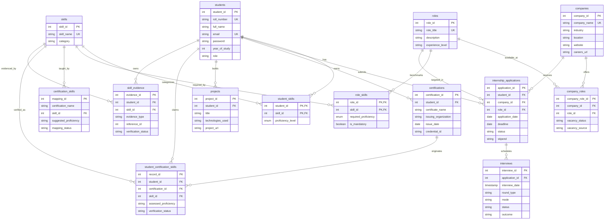

# Smart Internship & Skill Tracker (SINST)

A desktop software application designed to centralize and streamline a student's professional development journey. Built strictly using **pure Java (Swing + JDBC + OOP)** and **MySQL DBMS**.

---

## 📌 Project Overview

College students frequently struggle to manage their internship preparation and application processes efficiently. As they apply to numerous companies, tracking application dates, deadlines, interview schedules, and current application statuses manually becomes overwhelming. Furthermore, maintaining scattered records of personal skills, proficiency levels, certifications, and academic projects often leads to disorganized information, missed deadlines, and a fragmented view of one's professional readiness.

The **Smart Internship & Skill Tracker (SINST)** provides:
- **Student Authentication & Profile Management**: Secure registration and login using student roll numbers, credentials, and profile validation.
- **Internship Application Lifecycle Tracking**: Record target companies, roles, applied dates, deadlines, progressing statuses (`Applied`, `Under Review`, `Shortlisted`, `Interview`, `Accepted`, `Selected`, `Rejected`, `Withdrawn`), and stipends.
- **Interview Scheduling & History**: Schedule upcoming interviews, log rounds (Technical, HR, Coding Assessment), modes (`Online` vs `In-Person`), and track outcomes.
- **Skills Portfolio & Profile Management**: Catalog technical, database, framework, and soft skills alongside standardized proficiency levels (`Beginner`, `Intermediate`, `Advanced`, `Expert`), academic projects, and certifications.
- **Explainable Skill-Gap Analysis**: Direct relational database comparisons compare a selected target role's required skill competencies against the student's recorded profile, identifying exact missing competencies and calculating an explainable readiness percentage without external black-box algorithms.
- **Transparent Role Recommendations**: Multi-tier deterministic ranking that matches student demonstrated abilities with active and potential industry roles, distinguishing between verified evidence and unverified claims.
- **Dynamic Dashboard Summaries**: Uses SQL aggregate functions (`COUNT`, `GROUP BY`) and `JOIN` operations to display application status breakdowns and upcoming interview deadlines.
- **Accessibility & Dynamic Font Scaling**: Responsive in-app font scaling (`100%`, `115%`, `130%`, `150%`) with an interactive header dropdown and standard desktop zoom shortcuts (`Ctrl +`, `Ctrl -`, `Ctrl 0`) without altering or clipping layout geometry.

---

## 🛠️ Technology Stack (Pure Java + DBMS)

| Layer | Technology | Details |
| :--- | :--- | :--- |
| **Language & Runtime** | Java 21+ / JDK | Strictly adheres to Object-Oriented Programming (OOP) principles |
| **User Interface (GUI)** | Java Swing | Forms-based desktop experience with modern FlatLaf theme |
| **Build System** | Apache Maven 3.8+ | Standardized dependency management and executable packaging |
| **Database Management** | MySQL 8.0+ Server | Relational storage with 14 normalized tables & foreign key integrity |
| **Communication Bridge** | JDBC (Java Database Connectivity) | Parameterized `PreparedStatement` queries & transaction handling |
| **Theme & Styling** | FlatLaf 3.5.4 | Clean desktop look-and-feel with high-contrast UI geometry |

---

## 🏛️ Project Architecture

SINST is engineered using a strict **Layered Multi-Tier Architecture** that enforces clear separation of concerns, thread safety, and maintainability.

```
┌────────────────────────────────────────────────────────────────────────┐
│                        Presentation Layer (GUI)                        │
│          LoginFrame, MainFrame, Custom Renderers, Dialog Helpers        │
└───────────────────────────────────┬────────────────────────────────────┘
                                    │ Dispatches via
                                    ▼
┌────────────────────────────────────────────────────────────────────────┐
│               Asynchronous Threading Layer (AppExecutor)               │
│   Worker Thread Pool (Background JDBC) ──► EDT Callback Dispatch (GUI) │
└───────────────────────────────────┬────────────────────────────────────┘
                                    │ Invokes
                                    ▼
┌────────────────────────────────────────────────────────────────────────┐
│                     Service Layer (Business Rules)                     │
│    ApplicationService, CertificationService, SkillGapService, etc.     │
│       - ValidationUtil (Regex, Syntax, Date & Stipend Verification)    │
│       - UserSession (Thread-safe Identity & Authorization / IDOR)      │
│       - JDBC Transaction Boundaries (setAutoCommit, commit, rollback)  │
└───────────────────────────────────┬────────────────────────────────────┘
                                    │ Queries via
                                    ▼
┌────────────────────────────────────────────────────────────────────────┐
│                    Data Access Object Layer (JDBC)                     │
│    ApplicationDAO, SkillDAO, StudentDAO, RecommendationDAO, etc.       │
│       - DBConnection (Connection pooling, auto-reconnect, db.properties)│
│       - PreparedStatements with parameterized input binding            │
└───────────────────────────────────┬────────────────────────────────────┘
                                    │ Communicates with
                                    ▼
┌────────────────────────────────────────────────────────────────────────┐
│                    Relational Persistence Layer (DBMS)                 │
│              MySQL 8.0+ Server (14 Normalized Tables)                  │
└────────────────────────────────────────────────────────────────────────┘
```

### Layer Responsibilities
1. **Presentation Layer (`com.sinst.ui`)**: Pure Java Swing components (`JFrame`, `JPanel`, `JTable`, `JComboBox`). Contains zero SQL statements or business calculations; delegates all asynchronous tasks to `AppExecutor`.
2. **Asynchronous Execution Layer (`com.sinst.util.AppExecutor`)**: Employs an internal worker pool to offload blocking database network calls away from the Swing Event Dispatch Thread (EDT), dispatching results back onto the EDT via `onSuccess` and `onError` handlers with automatic busy cursor and button state management.
3. **Business & Service Layer (`com.sinst.service`)**: Enforces validation invariants, student authorization checks (IDOR defense), mathematical ranking calculations, and multi-step transactional boundaries.
4. **Data Access Object Layer (`com.sinst.dao`)**: Encapsulates JDBC communication through focused DAO interfaces and implementations utilizing parameterized `PreparedStatement` queries to prevent SQL injection.
5. **Database Layer (`MySQL 8.0+`)**: Persistent relational storage organized into 14 normalized tables enforcing primary, foreign key, and unique constraints.

---

## 🧩 Object-Oriented Programming (OOP) in SINST

SINST is designed strictly around core OOP principles without superfluous design patterns:

| OOP Concept | Application in SINST | Concrete Examples |
| :--- | :--- | :--- |
| **Encapsulation** | Domain entities guard state behind `private` fields, exposing strictly validated getters/setters and immutable identifiers. Invariant enforcement is localized to models and service validators. | `Student.java`, `Application.java`, `Certification.java`, `ProficiencyLevel.java`, `UserSession.java` |
| **Abstraction** | Service and DAO tiers define clean interfaces that decouple business logic and UI from concrete database implementations, enabling easy mocking and unit testing. | Interfaces: `ApplicationService`, `SkillGapService`, `RecommendationService`, `SkillDAO`, `StudentDAO`, `ApplicationDAO` |
| **Inheritance** | Domain specialization and exception hierarchy modeling. Specialized entities extend base entities; all custom domain exceptions inherit from a common base class. | `InternshipApplication` extends `Application`; `ValidationException`, `DatabaseException`, `UnauthorizedAccessException`, and `DuplicateEntityException` extend `SinstException` (which extends `Exception`) |
| **Polymorphism** | Dynamic method dispatch across interface references; multi-tier deterministic sorting contract via `Comparable<T>`; custom UI table cell rendering via `TableCellRenderer`. | `RoleRecommendation` implements `Comparable<RoleRecommendation>` with a 4-tier `compareTo` sorting contract; `StatusBadgeRenderer` overrides `DefaultTableCellRenderer` |
| **Composition** | Models represent composite real-world relationships by aggregating references rather than using fragile multiple inheritance. | `CompanyRole` composes `Company` and `Role` attributes; `Role` aggregates `List<Skill>`; `SkillEvidence` binds students to skills with audit references |

---

## 🗄️ Relational Database Schema & Relationships

The SINST database (`sinst_db`) consists of **14 interconnected relational tables** maintaining 3NF normalization, foreign key cascading constraints, and composite unique keys.



---

## 🗄️ Database Setup & Migration Instructions

### Scenario A: Clean Setup (Fresh Installation)
For a fresh setup on a local MySQL 8.0+ server:
```bash
mysql -u root -p < db/database.sql
```
*(Idempotent setup: initializes all 14 tables, triggers, and seeds standard industry roles, skills, and the demo student profile).*

### Scenario B: Upgrading an Existing Database
If upgrading from an earlier schema version, execute the versioned migrations in sequential order:
```bash
mysql -u root -p sinst_db < db/migration_v2.sql
mysql -u root -p sinst_db < db/migration_v3.sql
mysql -u root -p sinst_db < db/migration_v4.sql
mysql -u root -p sinst_db < db/migration_v5.sql
mysql -u root -p sinst_db < db/migration_v6.sql
```

For complete details on table definitions, schema versions, and SQL health-check queries, consult [`db/README.md`](db/README.md).

---

## 🎓 Certification-to-Skill Mapping Workflow

SINST provides a semi-automated, transparent certification mapping pipeline:

1. **Catalog Lookup**: When a student enters a certification name (e.g., *Oracle Certified Associate Java SE*), `CertificationService.findSuggestedSkills(certName)` queries `certification_skills` using SQL wildcard matching.
2. **Interactive Review**: The user interface presents an interactive confirmation dialog displaying all matched skills, learning outcomes, and suggested proficiency levels (`Beginner`, `Intermediate`, `Advanced`, `Expert`). The student can select or uncheck individual skills and adjust suggested levels before committing.
3. **Atomic Transaction**:
   - Inserts the certificate record into `certifications`.
   - Records mapping associations into `student_certification_skills`.
   - Inserts audit records into `skill_evidence` (`evidence_type = 'CERTIFICATION'`).
   - Updates `student_skills` using the **Non-Downgrade Rule**: If the student already possesses an equal or higher proficiency (e.g., student has `Advanced` and certification suggests `Intermediate`), the student's higher proficiency is strictly preserved.
4. **Transaction Integrity**: Wrapped in a JDBC transaction with `conn.setAutoCommit(false)`, `conn.commit()`, and `conn.rollback()` in the `catch` block to guarantee all-or-nothing atomicity.

---

## 📊 Explainable Skill-Gap Calculation Formula

SINST computes role readiness transparently from relational database benchmarks:

### 1. Four-Tier Proficiency Scale
Each proficiency level corresponds to a numeric domain rank:
$$\text{None} = 0, \quad \text{Beginner} = 1, \quad \text{Intermediate} = 2, \quad \text{Advanced} = 3, \quad \text{Expert} = 4$$

### 2. Numeric Level Gap
For each required skill $i$ defined in `role_skills`:
$$\text{LevelGap}_i = \max(0, \text{RequiredLevel}_i - \text{AssessedLevel}_i)$$

### 3. Fractional Match Value ($m_i \in [0.0, 1.0]$)
$$m_i = \begin{cases} 
1.0 & \text{if } \text{AssessedLevel}_i \ge \text{RequiredLevel}_i \\
\frac{\text{AssessedLevel}_i}{\text{RequiredLevel}_i} & \text{if } \text{AssessedLevel}_i < \text{RequiredLevel}_i \text{ and } \text{AssessedLevel}_i > 0 \\
0.0 & \text{if student does not possess skill } (\text{AssessedLevel}_i = 0)
\end{cases}$$

### 4. Overall Role Readiness Score
$$\text{Readiness \%} = \left( \frac{\sum_{i=1}^{N} (w_i \times m_i)}{\sum_{i=1}^{N} w_i} \right) \times 100$$
where:
- $w_i = 2.0$ for **mandatory** skills (`is_mandatory = TRUE`)
- $w_i = 1.0$ for **optional / secondary** skills (`is_mandatory = FALSE`)

### 5. Status Categorization
- **`Met`**: Candidate level meets or exceeds role requirement ($\text{LevelGap} = 0$).
- **`Partial`**: Candidate has the skill, but at a lower tier than required ($\text{LevelGap} > 0 \land \text{Level} > 0$).
- **`Missing`**: Candidate has not recorded or verified the skill ($\text{Level} = 0$).

> [!NOTE]
> If a role has no skills configured in the database, SINST reports a `0%` match with the explicit note **"Insufficient Role Data"**, preventing fabricated predictions.

---

## 🎯 Company & Role Recommendation Methodology

Recommendations are generated strictly from live database records:

1. **Relational Retrieval**: Retrieves active and potential company-role associations from `company_roles` joined with `companies` and `roles`.
2. **Transparent Match Scoring**: Evaluates the student's current proficiency across the role's required skills using the weighted formula described above.
3. **Deterministic 4-Tier Sorting Contract**:
   Every recommendation implements `Comparable<RoleRecommendation>` with deterministic ordering:
   1. **Primary**: Match Percentage (highest to lowest)
   2. **Secondary**: Detailed Weighted Score (highest to lowest)
   3. **Tertiary**: Role Title (alphabetical A–Z)
   4. **Quaternary**: Company Name (alphabetical A–Z)
4. **Truthful Vacancy Classification**:
   - `Active Campus Drive`: Officially confirmed campus recruitment.
   - `Official Careers Portal`: Active vacancy listing on the company careers site.
   - `Potential Role Match`: Competency alignment where no active listing is confirmed.
   - **No Fabricated Odds**: The system never produces misleading statements like *"95% chance of being hired"*.

---

## ⚙️ Building & Running

### Prerequisites
- **JDK 21 or higher** (`java -version`, `javac -version`)
- **MySQL 8.0+** running on `localhost:3306`
- **Maven 3.8+** (or use the included `mvnw.cmd` / `mvnw` wrapper)

### Build Commands
```cmd
:: Using Windows batch script:
compile.bat

:: Using Maven Wrapper:
mvnw.cmd clean package

:: Using System Maven:
mvn clean package
```
*Build output: `target/sinst-1.0.0.jar` (shaded executable Uber-JAR).*

### Running the Application
```cmd
:: Using Windows batch launcher:
run.bat

:: Launching packaged JAR:
java -jar target/sinst-1.0.0.jar
```

---

## 🧪 Automated Testing

SINST includes **179 automated tests** covering unit validation, transparent mathematical ranking, dynamic typography scaling, and database integration:

```cmd
:: Run tests via Windows batch script:
test.bat

:: Run tests via Maven Wrapper:
mvnw.cmd test

:: Run tests via System Maven:
mvn test
```

### Test Suite Structure
| Test Class | Focus Area | Test Count |
| :--- | :--- | :--- |
| [`InputValidationTest`](file:///c:/Users/shaik/OneDrive1/Desktop/CODING/SINST/test/com/sinst/unit/InputValidationTest.java) | Regex email, roll number, names, year of study (1–4), phone, date/timestamp bounds, negative stipend detection, URL validation, and error sanitization | 77 tests |
| [`ProficiencyAndSkillGapTest`](file:///c:/Users/shaik/OneDrive1/Desktop/CODING/SINST/test/com/sinst/unit/ProficiencyAndSkillGapTest.java) | 4-tier domain scale, numeric level gap, fractional match value, status categorization, and weighted score formula | 16 tests |
| [`RecommendationRankingTest`](file:///c:/Users/shaik/OneDrive1/Desktop/CODING/SINST/test/com/sinst/unit/RecommendationRankingTest.java) | Weighted formula ($w_m=2.0, w_o=1.0$), deterministic ranking, truthful reporting (`Potential Role Match`, 0% on empty roles), and deduplication | 10 tests |
| [`ApplicationLifecycleTest`](file:///c:/Users/shaik/OneDrive1/Desktop/CODING/SINST/test/com/sinst/unit/ApplicationLifecycleTest.java) | Valid application transitions, invalid status rejection, interview round bounds, modes, and chronological ordering | 38 tests |
| [`ServiceAuthorizationTest`](file:///c:/Users/shaik/OneDrive1/Desktop/CODING/SINST/test/com/sinst/unit/ServiceAuthorizationTest.java) | IDOR defense across student boundaries (`UnauthorizedAccessException`), admin override, and duplicate prevention | 5 tests |
| [`ConcurrencyAndResponsivenessTest`](file:///c:/Users/shaik/OneDrive1/Desktop/CODING/SINST/test/com/sinst/unit/ConcurrencyAndResponsivenessTest.java) | EDT safety, background pool execution, callback dispatch, UI responsiveness | 5 tests |
| [`CertificationMappingTest`](file:///c:/Users/shaik/OneDrive1/Desktop/CODING/SINST/test/com/sinst/unit/CertificationMappingTest.java) | 1:M cardinality between certifications and skills, learning outcomes, unknown cert handling | 4 tests |
| [`EvidenceTrackingTest`](file:///c:/Users/shaik/OneDrive1/Desktop/CODING/SINST/test/com/sinst/unit/EvidenceTrackingTest.java) | Verification status transitions, evidence audit trail, non-downgrade rule | 3 tests |
| [`FontManagerTest`](file:///c:/Users/shaik/OneDrive1/Desktop/CODING/SINST/test/com/sinst/unit/FontManagerTest.java) | Dynamic font zoom scaling bounds, reversible component tree sizing, table row scaling, and listener dispatches | 8 tests |
| [`ComprehensiveRegressionTest`](file:///c:/Users/shaik/OneDrive1/Desktop/CODING/SINST/src/com/sinst/test/SinstTestSuite.java) | Full regression suite asserting all 425 historical domain checks | 6 tests |
| [`DaoIntegrationTest`](file:///c:/Users/shaik/OneDrive1/Desktop/CODING/SINST/test/com/sinst/integration/DaoIntegrationTest.java) | Database CRUD, foreign key integrity, transactions, unique constraints, and offline fallback | 7 tests |

---

## 🔒 Known Limitations & Future Roadmap

In strict alignment with the project development scope, three security areas were explicitly deferred and remain intentionally outside the current development phase:

1. **Local Database Credentials in `db.properties`**:
   - *Current State*: Database host, username, and password are stored in plain text in `db.properties` for local desktop execution.
   - *Production Roadmap*: Migrate to an encrypted OS keystore (Windows Credential Manager / macOS Keychain) or system environment variables.
2. **Plain-Text Password Comparison in `StudentDAOImpl`**:
   - *Current State*: Passwords are compared directly as plain-text strings in the database query.
   - *Production Roadmap*: Implement salted cryptographic hashing (e.g., `Argon2id` or `BCrypt` with cost factor 12) before persisting or verifying credentials.
3. **Prefilled Demo Login Credentials in `LoginFrame`**:
   - *Current State*: Default roll number `25R11A0501` and password `password123` are prefilled in `LoginFrame` for academic demonstration and test evaluation.
   - *Production Roadmap*: Remove default prefilled values in release builds, requiring users to supply explicit credentials.

---

## 👥 Development Team

- **Amog Mantha** — `25R11A0505`
- **Aadil Ahmed Shaik** — `25R11A0501`
- **Shreyas Ratnaparkhi** — `25R11A0548`
